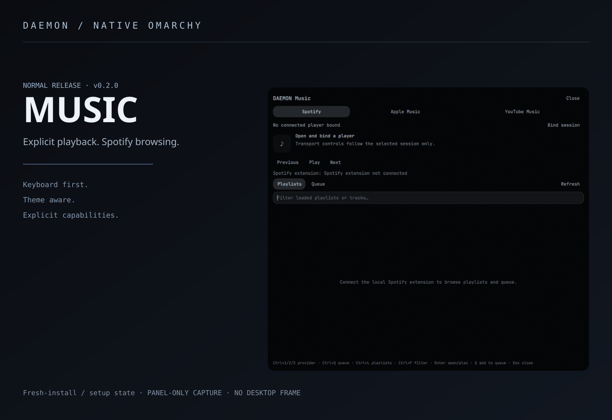

# DAEMON Music



[Full-size panel](assets/panel.png) · [Capture provenance](assets/PROVENANCE.md)

A keyboard-first native Omarchy music panel, with explicit player binding and a local **Spicetify relay** for Spotify playlists and queue.

**Release:** v0.2.0 · normal release for the capability set below. The artwork shows the real panel's fresh-install/setup state, not a connected private library.

## Supported capabilities

| Provider | Playback | Library / queue |
|---|---|---|
| Spotify desktop | Explicit MPRIS session; provider-exposed playback/seek/volume | Playlists, first200playlist tracks, upcoming queue, play URI and add-to-queue through Spicetify where available |
| Apple Music in a browser | Browser MPRIS session, when exposed and identified | Not implemented |
| YouTube Music in a browser | Browser MPRIS session, when exposed and identified | Not implemented |

Transport controls follow actual MPRIS capabilities. The panel does not silently choose the first player. Bind a session explicitly; service switching attempts to pause the previous selection rather than killing applications. Repeat/shuffle/output-device and complete provider catalog/search support are not promised. Search filters the loaded items; it is not a universal online catalog search. Large playlists are capped at200items in this release.

## Install and open

Requires Python3 and native Quickshell MPRIS support, plus a desktop player or browser exposing an identifiable MPRIS session. Spotify library/queue additionally require an authenticated Spotify desktop client with compatible Spicetify APIs. No Spotify OAuth access token is exported to the shell.

```sh
omarchy plugin add https://github.com/aarushdalal/daemon-music --enable
omarchy-shell shell toggle daemon0.music
```

Add the DAEMON Music widget through native bar settings if desired. It ships a custom SVG icon. Suggested optional Lua binding, after checking existing bindings:

```lua
o.bind("SUPER + M", "DAEMON Music", "omarchy-shell shell toggle daemon0.music")
```

Choose provider, open **Bind session**, and select the actual player. Browser service identity can be ambiguous: no authenticated Apple/YouTube playlist support is claimed.

## Connect Spotify / Spicetify

1. Configure Spotify and Spicetify normally, using their supported installation instructions. Inspect this repository first.
2. In the cloned/installed plugin folder, run `python3 tools/pair_spotify.py`. It prepares the public extension and a private local bootstrap, preserving existing files in a private pairing backup. It does not restart Spotify or run upstream installers.
3. Append both extensions, preserving your existing theme/extension list:

   ```sh
   spicetify config extensions daemon-music-session.js daemon-music.js
   spicetify apply --no-restart
   ```

4. Ensure the generated `daemon-music-session.js` inside Spotify's generated extensions directory is readable only by your user (`0600`); identify that directory from your own Spicetify/Spotify configuration. Do not weaken permissions or use sudo to force an unsupported installation. Gracefully restart Spotify yourself when ready.
5. Open DAEMON Music, bind Spotify, and Refresh Playlists or Queue. The loopback relay starts only while the panel is open.

[Official extension instructions](https://spicetify.app/docs/customization/extensions) document extension appending and applying. This release is a manual extension integration; no official Marketplace catalog acceptance is claimed. Local installed-entry metadata is best-effort and may change with Marketplace versions.

The local random pairing key lives in `~/.local/state/daemon-music/pairing.key` (private directory/file), and a private bootstrap is stored in your Spicetify extensions. **Exclude both, generated bootstrap copies, and pairing backups from Git, shared backups and uploads.** Never paste their contents into issues. The HTTP relay binds127.0.0.1:8975, authenticates requests and checks Spotify's origin; commands enter only through the parent QML process's stdio. Do not forward this port.

## Keyboard

Ctrl+1/2/3 provider · Ctrl+Q queue · Ctrl+L playlists · Ctrl+F filter · Enter open/play · Q add selected track to queue · Esc close. Unsupported operations show an unavailable/error state.

## Tests, troubleshooting and removal

```sh
python3 -m unittest discover -s tests -p 'test_*.py'
node tests/test_extension.cjs
```

12Python boundary/pairing tests and JavaScript dispatch/normalization checks pass. Authenticated Spotify library/queue were tested on the development host; this does not guarantee compatibility with future Spotify/Spicetify internals. Wrapper calls are capability checked. No browser DRM, sandbox or authentication modifications are performed.

- Not connected: confirm the panel is open, both extensions loaded in order, identical local pairing key, private permissions, and free loopback port. Spotify updates may require reapplying Spicetify normally.
- Empty list: Refresh, check capability/error state, and remember200item limits. Queue is the upcoming queue exposed by Spicetify.
- Player disappeared: re-open and explicitly rebind; the panel does not substitute an unrelated session.
- Disable the plugin through native plugin management. Remove both extension registrations with the Spicetify filename-minus syntax and reapply when ready; restore your private pairing backup if needed. Never remove unrelated extensions, themes or Spotify data.

Settings: `~/.config/omarchy/daemon-music.json`. [Security](SECURITY.md) · [Attribution](THIRD_PARTY.md) · [Changelog](CHANGELOG.md)
## Compatibility and installation safety

Requires the native Omarchy **Quattro/Quickshell plugin API** providing `qs.Ui`, `qs.Commons`, panel/service injection and native plugin management. Quickshell alone or older Omarchy releases are not sufficient. Tested on one Arch Linux/Hyprland/Omarchy installation; other versions are unverified. Keep the existing theme synchronization system: these panels consume native theme tokens.

Install/update only while the session is unlocked. Native plugin graph reloads can unload lock surfaces on the tested shell; these repos do not fix that host bug. Back up existing plugin/settings files, inspect the diff, and validate before enabling. No graphical-session restart, package installation or privileged setup is performed by this repository.
